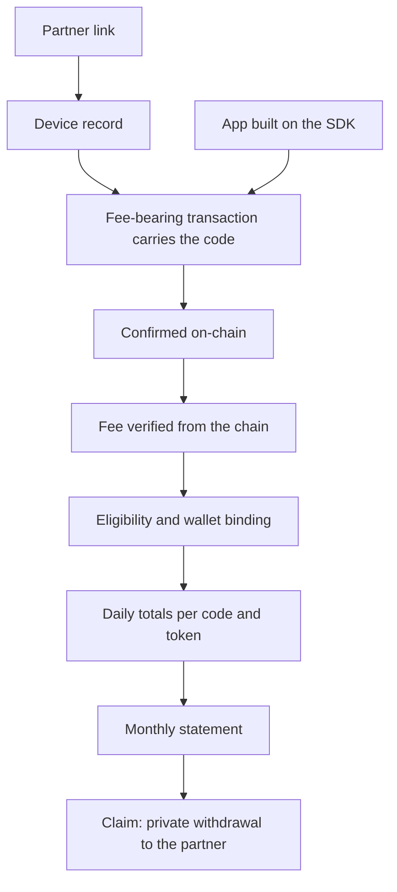

This page follows one partner code from the moment it enters a transaction to the moment it becomes commission on a statement. It is the technical companion to [How commission works](/affiliates/commission).



## 1. A code enters a transaction

A code reaches a transaction in one of two ways.

### From a partner link

A partner link is `https://cloak.ag/r/<code>`. Opening it redirects to `https://cloak.ag/r#<code>`, so the code travels in the URL fragment, which browsers never send to a server. The app reads it, removes it from the address bar, and decides whether to record it. A link of the form `https://cloak.ag/?ref=<code>` is handled the same way.

The app records the code only if every one of these holds:

| Check | Where it runs |
| --- | --- |
| The code is well formed: 3 to 24 characters of `a-z`, `0-9` and `_` | On the device |
| This device has never been attributed before | On the device |
| This device has no Cloak activity yet: no notes, no deposit history, no transaction history | On the device |
| The code belongs to an approved partner | One request to `GET https://api.cloak.ag/affiliates/status/<code>` |

The status request answers `{"active": true}` only for an approved partner. Pending, rejected, suspended, removed and unknown codes all get the same `{"active": false}`, so the endpoint cannot be used to learn which codes exist.

When every check passes, the browser stores one record in `localStorage` under the key `cloak_affiliate_v1`:

```json
{ "code": "alice_01", "clickedAt": "2026-01-15T10:00:00.000Z", "attributedOnce": true }
```

No wallet address is ever written to it. The record is never overwritten, so the first link a device opens is the only one it keeps, and `attributedOnce` stays after the window ends so the device is never attributed again. The Cloak mobile apps keep the same record in their own storage.

For two calendar months after `clickedAt`, the app attaches the code to the person's fee-bearing transactions. After that it stops attaching it, without changing the record.

### From an app built on the SDK

An app built on `@cloak.dev/sdk` passes the code as the `affiliateCode` option of a withdrawal, a send to an address or a swap. There is no link and no device record: the app decides when to attach the code. See [Earn with the SDK](/affiliates/sdk-integration) for the API.

### Which transactions carry a code

Only fee-bearing transactions carry a code, because commission is a share of the fee:

| Transaction | Carries the code |
| --- | --- |
| Withdraw, or private send to a public address | Yes |
| Private swap (at the swap's start, where the fee is taken) | Yes |
| Shield (deposit) | Never |
| Shielded transfer (funds stay in the pool) | Never |
| Internal steps that only merge notes | Never |

The code is part of the request the wallet signs for that transaction, so it cannot be changed or added after the person approves. It is never written on-chain: nothing in the Solana transaction says which partner, if any, it was attributed to.

## 2. The fee is verified on-chain

When a transaction carrying a code confirms, Cloak's affiliate service receives the event and treats it as a claim to check, not as a fact. Before anything accrues it reads the transaction from the chain through its own RPC and derives the fee the program actually collected: the signature and its success, the Cloak program, the kind of flow, the token, the gross amount, and the credit to the treasury, split with the pool's on-chain fee configuration at that transaction's slot.

- Only that chain-derived fee ever accrues. Commission is 20% of its **percentage** part; the fixed part is never shared.
- An event the chain contradicts is set aside, and a fee that no known pool configuration explains is held for review. Neither accrues.
- A transaction counts at most once, whatever reaches the service about it.

## 3. Eligibility and the wallet binding

The service then applies the rules a device cannot check:

| Rule | Result when it fails |
| --- | --- |
| The code belongs to an approved partner | Ignored |
| The sending wallet is not that partner's payout wallet (no self-referral) | Ignored |
| The token is a Cloak pool token and the amounts are consistent | Ignored |
| The wallet's first attribution | See below |

**First attribution, per wallet.** The first eligible transaction from a wallet binds that wallet to its code and opens a window of two calendar months from that transaction's day (clamped to the end of a shorter month). Inside the window, only transactions carrying the bound code accrue; a transaction from the same wallet carrying another partner's code accrues nothing. After the window, nothing from that wallet accrues again.

Because both layers apply, a person who arrived through a link earns their partner commission only while both the device window (from the click) and the wallet window (from the first attributed transaction) are open.

An ignored event never affects the transaction itself: the person's withdrawal or swap has already gone through, at the normal [fees](/guide/fees).

## 4. What Cloak stores, and what it never stores

| Stored | Not stored |
| --- | --- |
| Per partner code, token and day: the verified fee and the number of transactions | The sending wallet's address |
| A keyed fingerprint of each referred wallet for the month, used only to count distinct referrals | The transaction signature |
| The wallet binding: a keyed fingerprint of the wallet, the code, and the window's last day | Anything that links a wallet to a code in a form Cloak can read back |

The wallet binding's code is cleared 7 days after its window ends. The fingerprint and the window's last day are kept so the same wallet cannot be attributed again. The keyed fingerprints use secrets held by Cloak, so they cannot be reversed by anyone holding a list of wallets.

Partners see grouped, delayed, rounded totals, never individual transactions. A month's statement is issued only when it covers at least 3 distinct referrals. See [Why your dashboard is aggregated](/affiliates/dashboard-privacy).

## 5. From daily totals to a payout

1. **Close.** Shortly after 00:00 UTC on the 1st, the previous month closes into a statement per partner, one line per token, rounded down once per token.
2. **Review and funding.** The statement is reconciled against on-chain fee records and approved by two different finance approvers.
3. **Claim.** From the 5th (or later, once funding is verified) the partner claims it from the dashboard, for 90 days.
4. **Payment.** Each token is paid through a Cloak private withdrawal to the partner's payout wallet, in the token that earned it.

[Payouts and claiming](/affiliates/payouts) covers statement statuses and claiming in detail.
